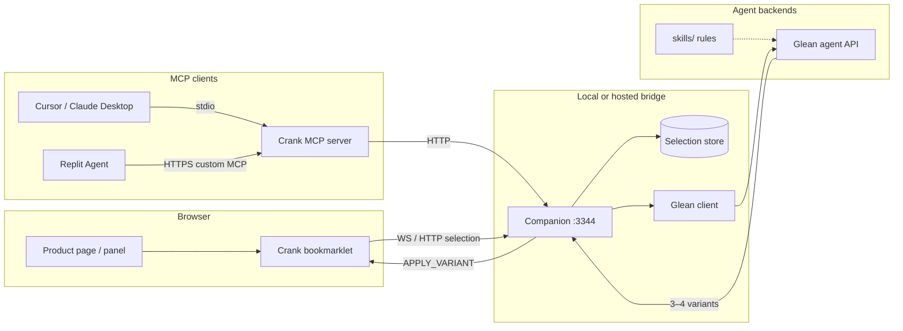

# Crank

Internal Motive tool for **copy iteration on live UI panels**.

Select a `div` → send its text nodes to a **Glean** agent (skills/rules aware) → review 3–4 copy options → apply the chosen variant via **MCP** into whatever product the panel is running in.

This repo is a **sibling extract** of patterns from [Vizpatch](../vizpatch) (inspect/select, companion bridge, text apply). It is intentionally separate so Vizpatch stays CSS-focused and Crank stays copy-focused.

---

## Architecture



### Flow

1. **Select** — Bookmarklet hover/click picks a `div`, extracts text nodes (`path`, `role`, `text`), posts to companion `/api/selection`.
2. **Propose** — Companion calls Glean (`glean-client.js`) with selection context. Stub returns deterministic variants when `GLEAN_STUB=true` (count = `CRANK_GLEAN_OPTION_COUNT`, default 3).
3. **Review** — Variants appear in the bookmarklet panel and/or via MCP tool `propose_copy_variants`.
4. **Apply** — Panel **Apply** (or MCP `apply_copy_variant`) updates live DOM **and** persists editable hardcoded literals via Vizpatch `text-writer`. **Preview** is DOM-only.
5. **Agent handoff (same chat)** — Panel **Agent** queues structured pending changes for MCP pull and copies a short phrase (`Apply the pending Crank change`) to the clipboard. Paste that phrase in your **current** Cursor chat (or keep an agent session that already has the `crank-apply-changes` skill). The agent calls `crank_get_formatted_changes` → edits source → `crank_clear_changes`. Optional secondary: **Open new chat instead** uses a `cursor://…/prompt` deeplink (opens a *new* prefilled chat — not the same Composer).

**There is no silent push into the IDE chat panel.** Cursor has no public “append to current Composer” API. MCP is pull-only (the agent calls tools). Prompt deeplinks always require user confirm ([docs](https://cursor.com/docs/reference/deeplinks): “never trigger automatic execution”) and open a new chat. Community workarounds (`composer.newAgentChat` + clipboard paste) also start a new chat — Crank does not ship those as primary. A background run via Cursor SDK / CLI (`Agent.prompt`, `agent -p`) is a separate agent — not the Composer chat — and needs `CURSOR_API_KEY`.

---

## Quick start (one command — Retune-style)

From your **app repo root** (Replit, Cursor terminal, or Codespaces — no paths):

```bash
npx crank setup   # once: MCP config, skill, devDependency, Vite inject
npx crank         # starts companion + dev + panel
```

MCP config uses **`npx -y crank mcp`** (like Retune) — no absolute paths. After setup, `crank` is added to `devDependencies` so virtual environments resolve it automatically.

**Agent chat:** paste `Apply the pending Crank change` or ask the agent to run `npx crank`. The agent should call **`crank_get_environment`** first to learn which repo and URLs are active.

That automatically:

1. **Detects** your app directory (`app/`, `client/`, `web/`, or repo root — same heuristics as Retune)
2. **Inits** MCP for Cursor / VS Code / Claude + installs the skill
3. **Starts** companion + `npm run dev` when a dev script exists
4. **Writes** `.crank/runtime.json` with public URLs for the panel loader

| Environment | Agent MCP | Panel |
|-------------|-----------|-------|
| **Cursor / Claude / VS Code** | `npx crank mcp` (stdio) | Vite auto-inject or bookmarklet |
| **Replit Agent** | HTTPS `/mcp` from `crank_get_environment` | Webview + bookmarklet |

Stop local daemon: `npx crank stop`

### Vizpatch reuse (UI + text dispatch)

Set `VIZPATCH_ROOT` (defaults to sibling `../vizpatch`). Crank reuses:

- **tool-ui CSS** — `/ui/vizpatch-ui.css`
- **control helpers** — `/ui/crank-ui-helpers.js` (buttons, fields, textareas)
- **hardcoded vs dynamic/bound** — `/ui/text-source.js` (`classifyTextSource`)
- **DOM preview** — Preview / Discard (`PREVIEW_TEXT_CHANGE`)
- **source save** — Save source (`SAVE_TEXT_CHANGE` → Vizpatch `text-writer.js`)
- Locked nodes show a badge + reason and cannot be edited in-panel

Useful variants:

```bash
npx crank init          # write configs only
npx crank start --daemon --no-open   # durable companion
npx crank --dev         # also runs npm run dev
npx crank --http-mcp    # force remote MCP (Replit-style)
npx crank doctor        # print detected environment
npx crank stop          # stop daemon
```

---

## Manual companion-only start

```bash
cd ~/Downloads/crank
cp .env.example .env   # if needed
npm install
node bin/crank.js start --daemon --no-open
```

Open `http://127.0.0.1:3344`, drag the **Crank** bookmarklet to the bookmarks bar, open any page, click the bookmarklet → **Select** → **Ask Glean**.

Stub demo without a browser (companion must be running):

```bash
npm run demo
```

### MCP (Cursor / Claude Desktop)

Companion must be running. Add to MCP config:

```json
{
  "mcpServers": {
    "crank": {
      "command": "node",
      "args": ["~/Downloads/crank/mcp-server/index.js"],
      "env": {
        "CRANK_COMPANION_URL": "http://127.0.0.1:3344",
        "CRANK_MCP_MODE": "stdio"
      }
    }
  }
}
```

Tools:

| Tool | Purpose |
|------|---------|
| `get_selected_copy` | Read active selection + text nodes |
| `propose_copy_variants` | Call Glean for 3–4 iterations |
| `apply_copy_variant` | DOM apply + source persist (set `persist:false` for preview) |
| `apply_custom_copy` | Apply agent-edited `nodes[]` (DOM) |
| `crank_get_formatted_changes` | Agent-ready markdown for pending Agent-button changes (Retune-style) |
| `crank_get_pending_changes` | Structured JSON diffs for pending changes |
| `crank_watch_changes` | Long-poll until pending changes appear |
| `crank_clear_changes` | Clear pending after apply |
| `crank_status` | Whether anything is queued |
| `get_pending_agent_prompt` | Legacy: read full queued prompt |
| `ack_pending_agent_prompt` | Legacy: clear pending after applying |
| `queue_agent_prompt` | Queue a variant for Cursor (same as **Agent**) |

### MCP (HTTP / Replit)

```bash
CRANK_MCP_MODE=http CRANK_MCP_HTTP_PORT=3345 npm run mcp:http
```

Expose `https://…/mcp` (tunnel or hosted) and add as a **custom MCP server** in Replit Integrations. Optional auth: set `CRANK_MCP_API_KEY` and pass `X-API-Key` in Replit advanced headers.

---

## Glean integration

Uses Motive Client API against `https://motive-prod-be.glean.com`.

Default agent: **Robot Content Designer** (`a866095fd53b419ab08338e3559fb7aa`) — generates + scores UX string options.

Env vars (see `.env.example`; secrets live in `.env`, gitignored):

| Variable | Role |
|----------|------|
| `GLEAN_BASE_URL` | Instance backend, e.g. `https://motive-prod-be.glean.com` |
| `GLEAN_API_KEY` | Client API bearer token |
| `GLEAN_AGENT_ID` | Agent Builder id (default = Robot Content Designer) |
| `GLEAN_ACT_AS` | Optional; required for global tokens |
| `GLEAN_STUB` | `true` = local stub variants; `false` = live agent |
| `CRANK_GLEAN_OPTION_COUNT` | Max options to request/parse (default **3**; was 4, was 6) |
| `GLEAN_USE_STREAM` | `true` = live SSE progress (same latency as `/runs/wait`) |
| `GLEAN_AGENT_TIMEOUT_MS` | Overall cap (default 5 min) |

**Latency:** Robot Content Designer typically takes **1–2 minutes** end-to-end. Most of that is inherent agent runtime (~55–90s silent phase before tokens). Stream vs wait does not materially change total time — stream only adds live progress UI. Set `GLEAN_STUB=true` for instant local dev.

Live path: `POST /rest/api/v1/agents/runs/stream` (preferred) or `/runs/wait` with the agent’s form fields. Companion parses Option N / Heading / Body / CTA from the agent markdown into `variants[]` for the panel + MCP.

---

## Replit MCP conclusion

**Replit Agent can consume MCP natively** — no browser extension is required for MCP itself.

Findings (as of Dec 2025 / docs current through 2026):

- Replit Agent supports the Model Context Protocol as a **client**: curated one-click servers plus **custom remote MCP servers** by HTTPS URL ([Connect via MCP](https://docs.replit.com/build/connect-via-mcp), [changelog 2025-12-12](https://docs.replit.com/updates/2025/12/12/changelog)).
- Custom servers are added under Integrations → MCP Servers → **Add MCP server** with an HTTPS endpoint; optional custom headers (e.g. `X-API-Key`) for static tokens ([MCP list / auth](https://docs.replit.com/references/mcp/overview)).
- Traffic is scanned by Replit’s security layer before tools run.
- Replit needs a **network-reachable HTTPS** MCP endpoint. Local `stdio` MCP (Cursor-style) does **not** work for Replit. Host Crank MCP with `CRANK_MCP_MODE=http` behind HTTPS (or a tunnel).

**What still needs a browser-side hook in Replit:**

| Concern | Native MCP? | What you need |
|---------|-------------|----------------|
| Agent calling `get_selected_copy` / `apply_copy_variant` | Yes (remote HTTPS MCP) | Hosted `mcp-server` |
| User selecting a `div` inside a Replit webview/preview | No | Bookmarklet (or a small content-script extension) injected into that page, talking to companion |
| Companion selection store on laptop localhost | Not reachable from Replit cloud | Host companion + MCP together, or tunnel both |

**Bottom line:** Replit does **not** need an extension for MCP. It **does** need (1) a remote HTTPS Crank MCP, and (2) something in the page (bookmarklet/extension) to capture the selection — same as local Cursor workflows.

---

## Repo layout

```text
crank/
├── bin/crank.js          # CLI: init, start --daemon, stop, status
├── bookmarklet/          # Div picker + text extract + panel
├── companion/            # Express + WebSocket bridge + Glean client
├── mcp-server/           # MCP tools (stdio + HTTP)
├── skills/               # Copy rules sent to / used by Glean
├── scripts/demo-flow.js  # Curl-less E2E stub demo
├── .env.example
└── README.md
```

---

## What was reused from Vizpatch vs new

| Area | Approach |
|------|----------|
| Element picker (highlight, click, Esc) | **Forked pattern** from `extension/content.js` / bookmarklet inspect |
| Companion Express + WS on fixed port | **Forked pattern** from `companion/server.js` (stripped CSS/sourcemap/VFS) |
| Text node write-back | **Simplified invent** — live DOM by path index; source-file `text-writer.js` not copied yet |
| Glean client + skills/ | **New** |
| MCP tool surface | **New** |
| tool-ui / CSS inspector chrome | **Not reused** (out of scope) |

---

## Key next steps (real Glean + product wiring)

1. Drop real `GLEAN_API_KEY` / `GLEAN_AGENT_ID`; set `GLEAN_STUB=false`.
2. Align request/response schema in `companion/glean-client.js` with the Motive Glean agent contract.
3. Point Glean at `skills/` (or sync rules into Glean’s skill store).
4. Optionally port Vizpatch `text-writer.js` for source-file persistence when the panel maps to a known project root.
5. For Replit: deploy companion + MCP HTTP behind HTTPS; document the Integrations URL + `X-API-Key`.
6. Harden MCP HTTP to the official Streamable HTTP transport if Replit’s client requires it beyond JSON-RPC `/mcp`.

---

## Status

Internal scaffold — runnable stubs. Not a production Motive service yet.
