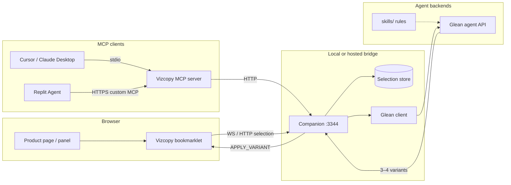

# Vizcopy

Internal Motive tool for **copy iteration on live UI panels**.

Select a `div` → send its text nodes to a **Glean** agent (skills/rules aware) → review 3–4 copy options → apply the chosen variant via **MCP** into whatever product the panel is running in.

This repo is a **sibling extract** of patterns from [Vizpatch](../vizpatch) (inspect/select, companion bridge, text apply). It is intentionally separate so Vizpatch stays CSS-focused and Vizcopy stays copy-focused.

---

## Architecture



### Flow

1. **Select** — Bookmarklet hover/click picks a `div`, extracts text nodes (`path`, `role`, `text`), posts to companion `/api/selection`.
2. **Propose** — Companion calls Glean (`glean-client.js`) with selection + `skills/` context. Stub returns 4 deterministic variants when `GLEAN_STUB=true`.
3. **Review** — Variants appear in the bookmarklet panel and/or via MCP tool `propose_copy_variants`.
4. **Apply** — MCP `apply_copy_variant` (or panel Apply) hits `/api/apply`; companion broadcasts `APPLY_VARIANT` so the live DOM updates node-by-node.

---

## Quick start

```bash
cd /Users/ahmed.nawaz/Downloads/vizcopy
cp .env.example .env
npm install
npm run companion
```

Open `http://127.0.0.1:3344`, drag the **Vizcopy** bookmarklet to the bookmarks bar, open any page, click the bookmarklet → **Select** → **Ask Glean**.

Stub demo without a browser (companion must be running):

```bash
npm run demo
```

### MCP (Cursor / Claude Desktop)

Companion must be running. Add to MCP config:

```json
{
  "mcpServers": {
    "vizcopy": {
      "command": "node",
      "args": ["/Users/ahmed.nawaz/Downloads/vizcopy/mcp-server/index.js"],
      "env": {
        "VIZCOPY_COMPANION_URL": "http://127.0.0.1:3344",
        "VIZCOPY_MCP_MODE": "stdio"
      }
    }
  }
}
```

Tools:

| Tool | Purpose |
|------|---------|
| `get_selected_copy` | Read active selection + text nodes |
| `propose_copy_variants` | Call Glean for 3–4 iterations |
| `apply_copy_variant` | Apply a Glean variant id |
| `apply_custom_copy` | Apply agent-edited `nodes[]` |

### MCP (HTTP / Replit)

```bash
VIZCOPY_MCP_MODE=http VIZCOPY_MCP_HTTP_PORT=3345 npm run mcp:http
```

Expose `https://…/mcp` (tunnel or hosted) and add as a **custom MCP server** in Replit Integrations. Optional auth: set `VIZCOPY_MCP_API_KEY` and pass `X-API-Key` in Replit advanced headers.

---

## Glean integration (stub → real)

Env vars (see `.env.example`):

| Variable | Role |
|----------|------|
| `GLEAN_API_URL` | POST endpoint for variant generation |
| `GLEAN_API_KEY` | Bearer token |
| `GLEAN_AGENT_ID` | Optional agent / workflow id |
| `GLEAN_STUB` | `true` (default) = no network, local variants |

Request body shape sent by `companion/glean-client.js`:

```json
{
  "agentId": "…",
  "sessionId": "…",
  "origin": "https://…",
  "pageUrl": "https://…",
  "selector": "div#…",
  "nodes": [{ "path": "0", "role": "heading", "text": "…" }],
  "combinedText": "…",
  "skills": [{ "name": "copy-guidance.md", "content": "…" }],
  "options": { "variantCount": 4 }
}
```

Expected response:

```json
{
  "variants": [
    {
      "id": "…",
      "label": "Concise",
      "summary": "…",
      "nodes": [{ "path": "0", "text": "…" }]
    }
  ]
}
```

Set `GLEAN_STUB=false` and fill `GLEAN_API_URL` / `GLEAN_API_KEY` when the real Motive Glean API is available. Adjust field names in `glean-client.js` only — keep the companion/MCP surface stable.

---

## Replit MCP conclusion

**Replit Agent can consume MCP natively** — no browser extension is required for MCP itself.

Findings (as of Dec 2025 / docs current through 2026):

- Replit Agent supports the Model Context Protocol as a **client**: curated one-click servers plus **custom remote MCP servers** by HTTPS URL ([Connect via MCP](https://docs.replit.com/build/connect-via-mcp), [changelog 2025-12-12](https://docs.replit.com/updates/2025/12/12/changelog)).
- Custom servers are added under Integrations → MCP Servers → **Add MCP server** with an HTTPS endpoint; optional custom headers (e.g. `X-API-Key`) for static tokens ([MCP list / auth](https://docs.replit.com/references/mcp/overview)).
- Traffic is scanned by Replit’s security layer before tools run.
- Replit needs a **network-reachable HTTPS** MCP endpoint. Local `stdio` MCP (Cursor-style) does **not** work for Replit. Host Vizcopy MCP with `VIZCOPY_MCP_MODE=http` behind HTTPS (or a tunnel).

**What still needs a browser-side hook in Replit:**

| Concern | Native MCP? | What you need |
|---------|-------------|----------------|
| Agent calling `get_selected_copy` / `apply_copy_variant` | Yes (remote HTTPS MCP) | Hosted `mcp-server` |
| User selecting a `div` inside a Replit webview/preview | No | Bookmarklet (or a small content-script extension) injected into that page, talking to companion |
| Companion selection store on laptop localhost | Not reachable from Replit cloud | Host companion + MCP together, or tunnel both |

**Bottom line:** Replit does **not** need an extension for MCP. It **does** need (1) a remote HTTPS Vizcopy MCP, and (2) something in the page (bookmarklet/extension) to capture the selection — same as local Cursor workflows.

---

## Repo layout

```text
vizcopy/
├── bookmarklet/          # Div picker + text extract + panel (Vizpatch-inspired)
├── companion/            # Express + WebSocket bridge + Glean client
├── mcp-server/           # MCP tools (stdio + HTTP)
├── skills/               # Copy rules sent to / used by Glean
├── scripts/demo-flow.js  # Curl-less E2E stub demo
├── .env.example
└── README.md
```

---

## What was reused from Vizpatch vs new

| Area | Approach |
|------|----------|
| Element picker (highlight, click, Esc) | **Forked pattern** from `extension/content.js` / bookmarklet inspect |
| Companion Express + WS on fixed port | **Forked pattern** from `companion/server.js` (stripped CSS/sourcemap/VFS) |
| Text node write-back | **Simplified invent** — live DOM by path index; source-file `text-writer.js` not copied yet |
| Glean client + skills/ | **New** |
| MCP tool surface | **New** |
| tool-ui / CSS inspector chrome | **Not reused** (out of scope) |

---

## Key next steps (real Glean + product wiring)

1. Drop real `GLEAN_API_URL` / `GLEAN_API_KEY` / `GLEAN_AGENT_ID`; set `GLEAN_STUB=false`.
2. Align request/response schema in `companion/glean-client.js` with the Motive Glean agent contract.
3. Point Glean at `skills/` (or sync rules into Glean’s skill store).
4. Optionally port Vizpatch `text-writer.js` for source-file persistence when the panel maps to a known project root.
5. For Replit: deploy companion + MCP HTTP behind HTTPS; document the Integrations URL + `X-API-Key`.
6. Harden MCP HTTP to the official Streamable HTTP transport if Replit’s client requires it beyond JSON-RPC `/mcp`.

---

## Status

Internal scaffold — runnable stubs. Not a production Motive service yet.
